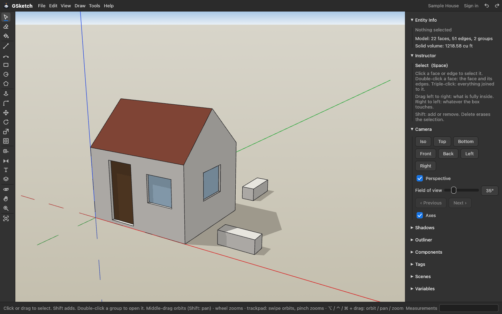

# GSketch

**Free SketchUp-style 3D modelling for Mac, Windows and Linux.** Draw a shape, push/pull it into a solid, snap to corners and axes, type exact sizes as you go, and send the panels to [GCarve](https://gcarve.app) to cut on a CNC router.

[**Download**](https://github.com/fillinthe/gsketch/releases/latest) · [Use it online](https://gsketch.app/app/) · [Website](https://gsketch.app) · [Support](https://gcarve.app/support/) · [Donate](https://gsketch.app/donate/)

## What it does

- **Draw:** lines, arcs, rectangles, circles, polygons and freehand. A closed flat loop becomes a face, a line across a face splits it, a shape drawn on a face cuts into it.
- **Build:** push/pull, Follow Me, offset, move, rotate, scale, flip, copy with ⌥, Solid Tools (union, subtract, intersect) and Intersect Faces.
- **Exact sizes:** type while you draw, with units and math: `4'6"`, `6 1/2"`, `1in + 5mm`, `24,36`. Name a size once (`width`, `t`) and type `width - 2*t` anywhere; groups sized by a name follow it.
- **Inference:** endpoints, midpoints, edges, faces, the red / green / blue axes, parallel and perpendicular to an edge, guide lines from the tape measure and protractor. Arrow keys lock an axis.
- **Organise:** groups and components, tags, scenes, an outliner, section planes, shadows by time of day, X-ray and wireframe, dimensions and text, 3D text, paint and wood grain.
- **For the shop:** a cabinet builder, a cut list and a printable cut sheet, and **Send to GCarve**: the flat panels go to GCarve one layer per stock thickness, ready for toolpaths.
- **Files:** opens SketchUp COLLADA (.dae) and STL exports, OBJ, DXF and SVG; exports STL, COLLADA (back to SketchUp), PNG images and panels as SVG / DXF. Saves `.gsk`.
- **Any mouse:** SketchUp, Fusion 360, Blender and VCarve mouse styles; no middle button needed (trackpad swipe orbits, pinch zooms, ⌥ / ⌃ / ⌘ + drag orbit / pan / zoom); 3Dconnexion SpaceMouse; ⌘K command palette and a searchable "How do I…?" guide.

## Download

Get the file for your computer from the [latest release](../../releases/latest). Nothing to install on Windows and Linux: unpack and run.

| Your computer | File |
|---|---|
| macOS (Apple Silicon and Intel) | `GSketch-0.1.8-macOS.dmg` |
| Windows 10 / 11 (64-bit) | `GSketch-0.1.8-Windows-x64.zip` |
| Windows 7 / 8 (64-bit) | `GSketch-0.1.8-Windows-win7-x64.zip` |
| Windows 7 / 8 / 10 (32-bit) | `GSketch-0.1.8-Windows-win7-x86.zip` |
| Linux x86_64 | `GSketch-0.1.8-Linux-x86_64.tar.gz` |
| Linux ARM64 (Raspberry Pi 4/5, ARM laptops) | `GSketch-0.1.8-Linux-aarch64.tar.gz` |

`SHA256SUMS.txt` in the release lists a checksum for every file: `shasum -a 256 -c SHA256SUMS.txt`.

### First start

- **macOS:** open the .dmg, drag GSketch to Applications. The app is not notarized by Apple yet, so the first time right-click it and choose **Open**.
- **Windows:** unzip, run `gsketch.exe`. It is not code-signed yet, so SmartScreen may say "unknown publisher": **More info → Run anyway**.
- **Linux:** `tar xzf` the file, then run `./gsketch` (or `./install.sh` to add it to your applications menu).

No account is needed on the desktop: models are `.gsk` files on your computer. To get the models you saved online, choose **Sign in** › **Sign in with your browser**: the website opens, you sign in there the way you always do (email link, passkey or password) and allow the computer; then **File › Open from Account** lists your models. The account is free and the same one as GCarve.

## System requirements

- **macOS:** Apple silicon, or Intel with macOS 10.12 or newer.
- **Windows:** 10 or 11 (64-bit), or 7 / 8 (64-bit and 32-bit builds). No installer, no admin rights.
- **Linux:** x86-64 or ARM64, glibc 2.30 or newer (Debian 11, Ubuntu 20.04 and later).
- **All:** OpenGL 2.0 graphics (any driver of the last ~15 years; Mesa is fine).

## Not what you need?

The browser version at [gsketch.app/app](https://gsketch.app/app/) is the same program, with nothing to install. It needs a free account, which keeps 3 cloud models (shared with GCarve projects); Pro adds 200. The desktop apps here are free.

## FAQ

**Is it really free?** Yes. The desktop apps are free with every tool and export. The online version needs a free account (3 cloud models).

**Is it SketchUp?** No. GSketch is an independent app that works the way SketchUp users expect: the same kind of tools, the same shortcuts (Space, L, R, C, P, M, Q, T…), the same push/pull way of building. Trimble has nothing to do with it.

**Can I open my SketchUp files?** Through an export: in SketchUp, File › Export › 3D Model as COLLADA (.dae) or STL, then open it in GSketch. Faces come back ready to push and pull. Export COLLADA from GSketch to take a model back. The `.skp` format itself is closed.

**Does it work offline?** Yes.

**I don't have a three-button mouse.** Swipe two fingers to orbit, Shift + swipe to pan, pinch to zoom, or hold ⌥ (orbit), ⌃ (pan) or ⌘ (zoom) while dragging.

## Help and feedback

- Questions, bugs and requests: [gcarve.app/support](https://gcarve.app/support/).
- Please attach the `.gsk` file that went wrong and say what you clicked.

## Licence

GSketch is free to use. The program and its files are © Fill in the Blank, all rights reserved; see [LICENSE.md](LICENSE.md), the [Terms](https://gcarve.app/terms/) and [Privacy](https://gcarve.app/privacy/) pages. This repository holds the downloads and release notes only; it is not the source code.

SketchUp is a trademark of Trimble Inc. GSketch is not affiliated with or endorsed by Trimble.
